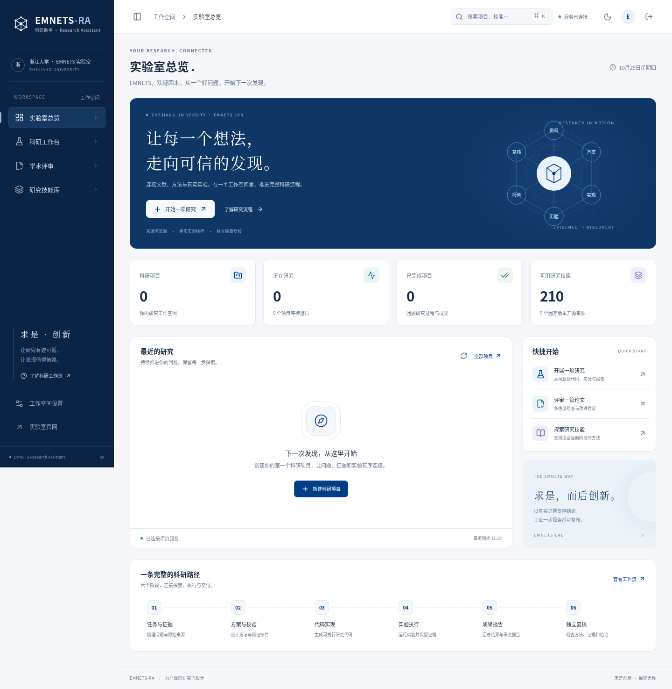

<h1 align="center">EMNETS-RA</h1>
<p align="center"><b>emnets科研助手 · EMNETS Research Assistant</b></p>

<p align="center">
  <a href="https://github.com/zjnno996/AutoResearch-Agent-Platform"></a>
  <a href="https://python.org"></a>
  <a href="https://nodejs.org"></a>
</p>

EMNETS-RA 是面向实验室的科研工作空间，包含 React + TypeScript 前端和 Python 后端，支持研究任务管理、实验执行、论文评审、技能检索与成果导出。界面采用求是蓝与 EMNETS 网络节点元素，支持深浅主题和移动端导航。

<p align="center"></p>

## 功能

| 模块 | 内容 |
| --- | --- |
| 科研工作台 | 创建任务，查看阶段进度、运行日志和研究产物，支持暂停与继续 |
| 六阶段研究流程 | 任务与来源梳理 → 方法设计 → 代码实现 → 实验执行 → 报告撰写 → 独立复核 |
| 实验与交付 | 保存代码、执行记录、数据表和图表，导出研究报告与实验文件 |
| 学术评审 | 上传论文、选择评审维度，查看历史评审并导出 Markdown / PDF |
| 技能库 | 210 项固定版本的科研与工程技能，支持检索和按研究阶段选择 |
| 服务与资源 | 查看后端连接、资源状态和实际项目统计 |

研究流程使用带哈希校验的检查点，局部修订时保留有效成果。实验执行记录、内部科学复核与外部 benchmark 评分分别保存和报告。技能可能需要额外科学软件或外部工具，安装项目不会自动提供这些服务的账号和凭据。

## 快速启动

需要 Python 3.11 / 3.12，以及 Node.js 20.19+ 或 22.12+。

```bash
git clone https://github.com/zjnno996/AutoResearch-Agent-Platform.git EMNETS-RA
cd EMNETS-RA
./scripts/setup-web.sh
```

将模型服务配置保存在 Git 仓库之外：

```bash
mkdir -p "${XDG_CONFIG_HOME:-$HOME/.config}/emnets-ra"
cp -n .env.example "${XDG_CONFIG_HOME:-$HOME/.config}/emnets-ra/provider.env"
chmod 600 "${XDG_CONFIG_HOME:-$HOME/.config}/emnets-ra/provider.env"
```

编辑私有的 `provider.env`，填写自己的 API 地址和密钥。当前默认模型为 **Qwen3.8-27B-FP8**，研究、代码和评审角色使用配置的同一模型。模型凭据由后端读取。

```bash
./start-web.sh start
./start-web.sh status
```

浏览器访问 **http://localhost:5910/**。启动脚本会自动加载私有配置；可通过 `EMNETS_RA_ENV_FILE` 指定其他配置文件，通过 `PYTHON_PATH` 指定 Python 解释器。更多部署、接口和验证说明见 [Web 工作空间文档](docs/web-workspace.md)。

## 项目结构

```text
frontend-web/        Web 前端
backend/services/    科研调度、论文评审与资源服务
backend/agent/       研究引擎、实验工具与技能库
scripts/            安装、启动辅助与评测检查脚本
docs/               架构、配置与评测说明
frontend/           历史桌面前端兼容入口
```

历史桌面入口使用 `./start.sh`，默认页面地址为 `http://localhost:5903/`。日常使用推荐上面的 Web 工作空间。

## 文档与评测

- [Web 工作空间与部署](docs/web-workspace.md)
- [研究引擎与技能来源](docs/research-engine.md)
- [架构与容错机制](docs/architecture-upgrade.md)
- [ResearchClawBench 接入](docs/researchclawbench.md)
- [敏感信息与发布检查](docs/publishing.md)

项目提供 ResearchClawBench 适配器。外部评测数据与评分器需要独立安装，运行目录、账号、日志和评分缓存不随代码发布。网页任务跑通或内部复核通过，不代表已完成官方榜单评测。

## 来源与许可

第三方代码和技能的来源、固定版本及许可证见 [THIRD_PARTY_NOTICES.md](THIRD_PARTY_NOTICES.md)。各组件保留其原始许可说明。

项目问题和建议请通过 [本仓库 Issues](https://github.com/zjnno996/AutoResearch-Agent-Platform/issues) 提交。
